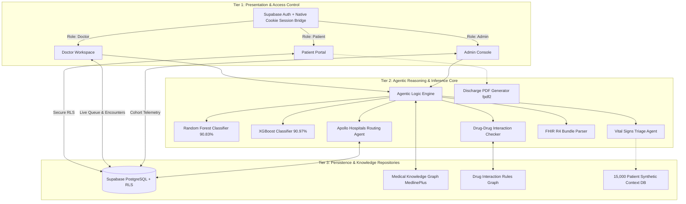
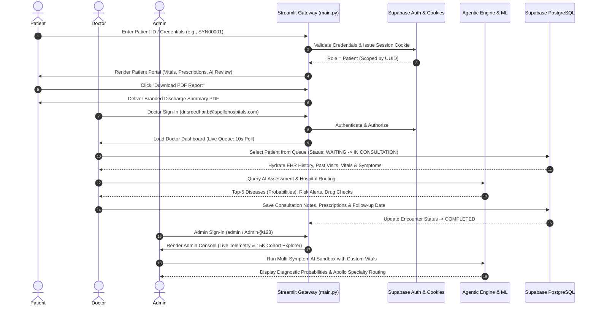
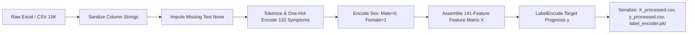
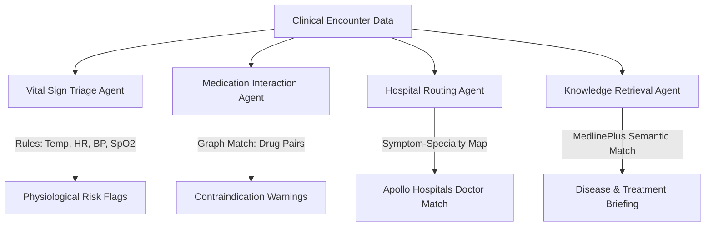

# Agentic AI in Healthcare – Intelligent Clinical Diagnostic Assistant

[](https://www.python.org/)
[](https://streamlit.io/)
[](https://supabase.com/)
[](https://scikit-learn.org/)
[](https://xgboost.ai/)
[](https://hl7.org/fhir/)
[](LICENSE)

An end-to-end, multi-agent clinical decision-support ecosystem developed as a **B.Tech CSE Final-Year Capstone Project**. The platform harmonizes **Ensemble Machine Learning (Random Forest & XGBoost)**, **Deterministic Clinical Triage Agents**, **HL7 FHIR R4 Interoperability**, **Drug-Drug Interaction Screening**, **Hospital Departmental Routing for Apollo Hospitals**, and **Role-Based Workspaces (Patient, Doctor, Admin)** into a unified clinical workstation.

> [!IMPORTANT]
> **Academic & Clinical Disclaimer:** This platform is an **academic clinical decision-support prototype**. It is not FDA-cleared, CE-marked, or clinically validated for independent medical diagnosis or prescribing. The system operates on clinical data ingestion (EHR/FHIR and clinician/patient inputs) without real-time physical IoT device telemetry (which is planned for future phases). All outputs serve strictly as decision-support aids for qualified clinicians, who remain the final decision-makers.

---

## 📑 Table of Contents
1. [System Architecture](#-system-architecture)
2. [End-to-End Clinical Workflow](#-end-to-end-clinical-workflow)
3. [Technology Stack](#-technology-stack)
4. [Dataset & Preprocessing (15K Synthetic Cohort)](#-dataset--preprocessing-15k-synthetic-cohort)
5. [Authentication & Session Engine](#-authentication--session-engine)
6. [Detailed Workspace Breakdown (All 3 Dashboards)](#-detailed-workspace-breakdown-all-3-dashboards)
   - [Patient Portal](#1-patient-portal-patient_dashboardpy)
   - [Doctor Consultation Workspace](#2-doctor-consultation-workspace-doctor_dashboardpy)
   - [Admin Console & AI Sandbox](#3-admin-console--ai-sandbox-admin_dashboardpy)
7. [Machine Learning Diagnostics & Benchmarks](#-machine-learning-diagnostics--benchmarks)
8. [Clinical Agentic Reasoning Engines](#-clinical-agentic-reasoning-engines)
9. [HL7 FHIR R4 Interoperability](#-hl7-fhir-r4-interoperability)
10. [Repository Directory Structure](#-repository-directory-structure)
11. [Demo Credentials](#-demo-credentials)
12. [Installation & Setup Guide](#-installation--setup-guide)
13. [Security, Governance & Row-Level Security](#-security-governance--row-level-security)
14. [Future Scope & Planned IoT Extensions](#-future-scope--planned-iot-extensions)

---

## 🏗️ System Architecture

The application adopts a decoupled, multi-tiered architecture that separates presentation state, agentic orchestration, inference pipelines, and PostgreSQL persistence:



---

## 🔄 End-to-End Clinical Workflow

From patient admission to discharge summary generation, every transaction moves through a governed clinical lifecycle:



---

## 💻 Technology Stack

| Layer | Technologies & Libraries | Architectural Purpose |
| :--- | :--- | :--- |
| **User Interface** | Streamlit `v1.35+`, Custom Injected CSS | Clean responsive dashboards, dark/light modes, pill tabs, micro-animations, Inter font. |
| **Authentication** | Supabase Auth, PKCE OAuth, Cookie Storage | Role-Based Access Control (RBAC), Google OAuth, 6-digit email OTPs, persistent session cookies. |
| **Database & ORM** | Supabase PostgreSQL, PostgREST, Python `supabase` client | Multi-tenant medical storage, Row-Level Security (RLS) policies, relational schema. |
| **Machine Learning** | Scikit-Learn `v1.3+`, XGBoost `v2.0+`, Joblib | 41-class multi-disease classification, probability ranking, model persistence. |
| **Data Processing** | Pandas `v2.0+`, NumPy `v1.24+`, OpenPyXL | High-throughput manipulation of 15,000-row synthetic matrices and Excel spreadsheets. |
| **Synthetic Modeling** | Faker `v20.0+` (`en_IN` & `en_US` providers) | Culturally accurate Indian patient demographic synthesis with unique identity constraints. |
| **Medical Standards** | HL7 FHIR R4 JSON Specifications | Ingestion and standard parsing of `Patient`, `Condition`, `Observation`, `MedicationStatement`. |
| **PDF Generation** | `fpdf2` (Fast, Pure-Python PDF Engine) | Real-time generation of hospital-branded clinical discharge summaries. |
| **Knowledge Systems** | JSON-based Knowledge Graphs, MedlinePlus / NIH | Semantic medical concept mapping, drug interaction matrices, severity ratings. |

---

## 📊 Dataset & Preprocessing (15K Synthetic Cohort)

### 1. Synthetic Cohort Architecture
The system utilizes a 15,000-record clinical context dataset located at `data/raw/agentic_ai_patient_context_15000_with_names.xlsx`:
- **Sample Volume:** 15,000 unique patient encounters.
- **Demographics:** Culturally grounded names generated with `Faker('en_IN')` (`generate_names.py`), verified for 100% uniqueness.
- **Disease Classes:** 41 distinct pathologies evenly distributed across infectious, chronic, gastrointestinal, respiratory, and metabolic conditions.
- **Feature Space (141 Total Dimensions):**
  - **132 Binary Symptoms:** Tokenized one-hot features (`itching`, `skin_rash`, `high_fever`, `breathlessness`, `abdominal_pain`, etc.).
  - **7 Vital & Demographic Predictors:**
    - `age` (Continuous integer: 1–100)
    - `sex_encoded` (Categorical: Male=0, Female=1, Other=2, Unknown=3)
    - `temperature_c` (Continuous Celsius: e.g., 36.5–40.2°C)
    - `heart_rate_bpm` (Continuous BPM: e.g., 55–125 bpm)
    - `systolic_bp_mmhg` (Continuous mmHg: e.g., 85–180 mmHg)
    - `diastolic_bp_mmhg` (Continuous mmHg: e.g., 55–110 mmHg)
    - `spo2_percent` (Continuous percentage: e.g., 84.0–99.5%)

### 2. Preprocessing Pipeline (`preprocess.py`)


### 3. Supplementary Historical Data
The repository also houses clean symptom-disease validation sets (`data/Training.csv` and `data/Testing.csv`) with 132 symptoms mapping directly to 41 prognoses for cross-validation checks.

---

## 🔐 Authentication & Session Engine

The entry portal (`src/pages/login.py`) provides multiple authentication avenues coupled to an enterprise session bridge:

### 1. Authentication Modalities
1. **Role-Based Email & Password:**
   - **Patients:** Log in with Patient Code (`SYN00001` - `SYN15000` with password `Patient@<ID_NUM>`, or fallback `P001` with `Patient@123`).
   - **Doctors:** Access with verified hospital credentials (`dr.sreedhar.b@apollohospitals.com` / `Doctor@123` or short ID `doctor`).
   - **Administrators:** High-privilege console access (`admin` / `Admin@123`).
2. **One-Time Passcode (OTP):** Generates and transmits a time-sensitive 6-digit passcode to the user's email via Supabase Auth.
3. **Google OAuth 2.0:** Secure PKCE authorization redirecting through Google Identity services.
4. **New Patient Self-Registration:** Allows unregistered individuals to provide full demographics (Name, Age, Gender, DOB, Pre-existing conditions) and immediately registers their profile into Supabase.

### 2. Native Cookie Bridge & Race-Condition Prevention
- Traditional Streamlit sessions wipe upon full page reloads. To counter this, `main.py` and `login.py` utilize a **native JavaScript cookie bridge**:
  ```javascript
  document.cookie = "auth_role=doctor; path=/; max-age=31536000";
  document.cookie = "auth_username=dr.sreedhar.b@apollohospitals.com; path=/; max-age=31536000";
  window.parent.location.reload();
  ```
- Instant hydration reads cookies through `st.context.cookies`, restoring authenticated state before widget initialization to guarantee **zero widget flashes and zero session desyncs**.

---

## 🖥️ Detailed Workspace Breakdown (All 3 Dashboards)

### 1. Patient Portal (`patient_dashboard.py`)

A patient-centric health dashboard designed for transparent communication of medical history and AI review:

| Tab / Section | Features & Functional Capability |
| :--- | :--- |
| **Top Profile Header** | Displays patient name, system ID, age, gender, and hospital affiliation with banner design. |
| **Tab 1: Dashboard** | **KPI Status Cards:** Current Care Status (diagnosis), Last Visit Date, Next Scheduled Follow-up, Active Medicines Count.<br>**Vitals Grid:** Live cards for Heart Rate (bpm), SpO₂ (%), Temperature (°C), and BP (mmHg).<br>**Reported Symptoms:** Pill-segmented read-only tags.<br>**Medical History:** Pre-existing condition badges with safety highlights. |
| **Tab 2: Medical History** | **Active Prescriptions:** Dosage, frequency, duration, and doctor instructions.<br>**Past Clinical Visits:** Interactive expanders showing consultation date, attending doctor, recorded diagnosis, doctor's clinical notes, and future care plans. |
| **Tab 3: AI Insights** | **Side-by-Side Review:** Compares Doctor's Confirmed Assessment against AI-Assisted Differential Prediction with confidence levels.<br>**Risk & Safety Alerts:** Visual badges indicating vital flag status and prescription safety alerts. |
| **Tab 4: Profile & Data** | **Demographics Card:** Summary of personal attributes.<br>**PDF Discharge Summary Engine:** One-click generation and download of an official, hospital-branded Clinical Discharge PDF summary via `fpdf2`. |
| **Synthetic Auto-Link** | When synthetic demo patients (`SYN00001`+) log in, the system automatically checks for a database record. If unlinked, an automated one-click action creates the Supabase patient row and links it in `patient_auth`. |

---

### 2. Doctor Consultation Workspace (`doctor_dashboard.py`)

A dedicated clinical environment tailored for **Dr. V Sukaveni** (Internal Medicine, Apollo Hospitals):

| Section / Workspace | Features & Functional Capability |
| :--- | :--- |
| **Sidebar Profile** | Clinician card displaying doctor name, specialty, hospital branch, and fast navigation menu. |
| **🏠 Today's Overview** | Real-time metric cards summarizing **Today's Encounters**, **Completed Visits**, **Waiting Patients**, and **Upcoming Follow-ups**. |
| **👥 Today's Patients (Live Queue)** | Built with `@st.fragment(run_every="10s")` for **zero-page-flicker live auto-refresh**.<br>Displays Patient ID, Name, Age, Gender, Department, and real-time status badges (`WAITING`, `IN CONSULTATION`, `COMPLETED`).<br>Clicking "Review Patient" transitions patient status to `IN CONSULTATION` and loads the clinical workspace. |
| **Review Workspace: Profile** | Comprehensive patient demographics, date of birth, latest visit history, and recorded diagnoses. |
| **Review Workspace: Briefing** | Auto-synthesized Doctor Briefing summarizing recent clinical developments and active alerts. |
| **Review Workspace: Routing** | Dynamic assessment of symptom-specialty alignments and relevant on-duty doctors at Apollo Hospitals. |
| **Review Workspace: Past Visits** | Historical consultation archive with past diagnoses, clinical notes, and historical drug regimens. |
| **Review Workspace: Today's Visit** | **Context Summary:** Read-only symptoms, vitals, active medications, and AI inference.<br>**Clinical Input Form:** Doctor's definitive diagnosis, clinical notes, multi-attribute prescription builder (Name, Dosage, Frequency, Duration, Instructions), care plan, and follow-up date picker.<br>**Submission:** Commits visit and medications to Supabase and marks encounter as `COMPLETED`. |
| **Review Workspace: Saved Report** | Formatted live preview of the newly saved encounter report. |

---

### 3. Admin Console & AI Sandbox (`admin_dashboard.py`)

An administrative command center featuring system telemetry, a complete cohort browser, and an interactive AI sandbox:

| Section / Workspace | Features & Functional Capability |
| :--- | :--- |
| **Overview Dashboard** | **Executive KPI Cards:** Total Patients Registered (1,248+), AI Assessments Run (432+), Critical Alerts Requiring Review (18), System Operational Status.<br>**Live AI Routing Activity Feed:** Real-time log showing Patient ID, primary symptoms, AI triage disposition (`ER ROUTING`, `GENERAL WARD`, `OPD APPOINTMENT`, `URGENT CARE`), and timestamp.<br>**Telemetry Meters:** Diagnostic accuracy meter (94.2%), Routing efficiency meter (98.5%), and Model latency (120ms). |
| **All 15k Patients Browser** | Interactive database browser rendering all 15,000 synthetic patient cohort entries (`patient_id`, `patient_name`, `age`, `sex`) directly from the preprocessed context database. |
| **AI Assessment Workspace** | **FHIR / EHR Search & Register:** Search by ID (e.g., `P001` or `SYN00001` - `SYN15000`) across Supabase and the 15K cohort. Includes modal for registering new patients with optional portal credential generation.<br>**EHR Profile Loader:** "Use FHIR Data for Assessment" auto-populates all inputs.<br>**Patient Demographics:** ID, Name, Age, Sex.<br>**Symptom Vector Input:** Multi-symptom text entry with intelligent medical alias normalization.<br>**Vital Sign Inputs:** Temperature (°C), Heart Rate (bpm), Systolic BP, Diastolic BP, SpO₂ (%).<br>**Vital Risk Engine:** Auto-computes and flags physiological hazards (Hypothermia, Hyperthermia, Tachycardia, Bradycardia, Hypertension, Hypotension, Low Oxygen).<br>**Ensemble Prediction:** Computes Random Forest & XGBoost multi-class probabilities, outputs Top-5 disease differentials with percentages and confidence levels (HIGH / MODERATE / LOW).<br>**Drug Interaction Checker:** Real-time contraindication screening across entered medications.<br>**Hospital Department Routing:** Recommends appropriate department and active doctors at Apollo Hospitals. |

---

## 📈 Machine Learning Diagnostics & Benchmarks

### 1. Classification Benchmarks (15,000 Patient Cohort)
Both models were trained with stratified 80/20 train-test splits on the 141-feature dataset:

| Model Architecture | Configuration & Hyperparameters | Features | Classes | Test Accuracy | Model Path |
| :--- | :--- | :---: | :---: | :---: | :--- |
| **XGBoost Classifier** | 300 estimators, depth=6, `eta=0.05`, `multi:softprob`, subsample=0.8 | 141 | 41 | **90.97%** | `models/xgboost_model.pkl` |
| **Random Forest** | 300 trees, balanced class weights, Gini criterion, `n_jobs=-1` | 141 | 41 | **90.83%** | `models/random_forest_model.pkl` |

### 2. Clinical Confidence Tiers
To safeguard against machine overconfidence, raw probabilities are mapped to clinical action tiers:
- **🟢 HIGH ($\ge 70\%$):** Clear diagnostic separation among candidates. System presents primary disease candidate with high confidence.
- **🟡 MODERATE ($40\% - 69\%$):** Secondary differential possibilities exist. Prompts the clinician to review vital trends and request targeted laboratory investigations.
- **🔴 LOW ($< 40\%$):** Inconclusive presentation. Generates a clinical uncertainty warning advising the provider to collect additional history and perform physical examinations.

---

## 🧠 Clinical Agentic Reasoning Engines



1. **Vital Signs Triage Agent (`src/agents/patient_assessment.py`):**
   - Evaluates physiological telemetry against strict medical ranges:
     - **Temperature:** Hyperthermia ($\ge 39.0^\circ\text{C}$), Hypothermia ($< 35.0^\circ\text{C}$)
     - **Heart Rate:** Tachycardia ($> 100\text{ bpm}$), Bradycardia ($< 60\text{ bpm}$)
     - **Blood Pressure:** Hypertension ($\ge 140/90\text{ mmHg}$), Hypotension ($< 90/60\text{ mmHg}$)
     - **Oxygenation:** Critical Hypoxemia ($< 90\%$), Reduced Saturation ($< 94\%$)
2. **Medication Interaction Screening Agent (`src/knowledge/medication_checker.py`):**
   - Normalizes drug aliases (e.g., Acetylsalicylic acid $\to$ Aspirin, Acetaminophen $\to$ Paracetamol).
   - Traverses a curated drug knowledge graph (`knowledge/medication_knowledge.json`) to detect severe interactions (e.g., **Aspirin + Warfarin** bleeding risk, **Aspirin + Ibuprofen** GI ulcer risk).
3. **Hospital Routing Agent (`src/agents/hospital_routing_agent.py`):**
   - Maps normalized symptom vectors to hospital departments (`Orthopaedics`, `Internal Medicine`, `General Surgery`, `Gynaecology`, `Pediatrics`, `Dentistry`).
   - Queries Supabase for matching departments and listed physicians stationed at **Apollo Hospitals**.
4. **Medical Knowledge Retrieval Engine (`src/knowledge/knowledge_retrieval.py`):**
   - Synthesizes authoritative clinical context (disease summaries, common presentations, diagnostic pathways) sourced from **MedlinePlus / U.S. National Library of Medicine**.

---

## 🏥 HL7 FHIR R4 Interoperability

The module in `src/fhir/parser.py` parses standard HL7 FHIR R4 JSON bundles (`fhir/patient.json`):
- **Resources Extracted:**
  - `Patient`: Extracts demographic identifiers, given/family names, gender, birth date, and computed age.
  - `Condition`: Ingests active and historical medical diagnoses (`verificationStatus`, `clinicalStatus`).
  - `Observation`: Extracts recorded vital signs (temperature, heart rate, blood pressure, SpO₂).
  - `MedicationStatement`: Ingests current medications and dosages.
- **Architectural Isolation:** FHIR imports hydrate read-only session states without corrupting manual assessment forms.

---

## 📂 Repository Directory Structure

```text
healthcare-agentic-ai/
├── main.py                     # Main application entry point & session router
├── requirements.txt            # Pegged Python project dependencies
├── .env                        # Supabase credentials and API keys
├── README.md                   # Complete architectural & operational guide
├── predict_patient.py          # Standalone patient prediction demo script
├── preprocess.py               # Feature extraction and encoding pipeline (15K dataset)
├── train_model.py              # Random Forest training and serialization script
├── train_xgboost.py            # XGBoost training and evaluation script
├── generate_names.py           # Synthetic patient name generator (Faker en_IN)
│
├── src/                        # Primary application source code
│   ├── pages/                  # Streamlit role-based dashboards
│   │   ├── login.py            # Multi-role authentication & OAuth portal
│   │   ├── patient_dashboard.py # Patient portal & records viewer
│   │   ├── doctor_dashboard.py # Live queue & consultation workspace
│   │   └── admin_dashboard.py  # System operations & 15K cohort browser
│   │
│   ├── agents/                 # Clinical agentic reasoning modules
│   │   ├── hospital_routing_agent.py # Apollo Hospitals department routing
│   │   └── patient_assessment.py     # Vital signs triage heuristics
│   │
│   ├── ml/                     # Machine learning pipelines
│   │   ├── predict.py          # Interactive symptom inference script
│   │   ├── train_model.py      # RF & XGBoost benchmark training
│   │   ├── cross_validation.py # Stratified K-fold cross-validation
│   │   ├── eda.py              # Exploratory data analysis scripts
│   │   └── preprocess_data.py  # Data preprocessing utilities
│   │
│   ├── services/               # Integrations & backend utilities
│   │   ├── supabase_client.py  # Supabase PostgreSQL, Auth, & RLS client
│   │   ├── hospital_client.py  # Apollo Hospitals departments & doctors API
│   │   ├── synthetic_data.py   # 15K patient dataset retrieval helper
│   │   └── pdf_generator.py    # Branded discharge summary generator (fpdf2)
│   │
│   ├── fhir/                   # Healthcare standards interoperability
│   │   └── parser.py           # HL7 FHIR R4 JSON bundle parser
│   │
│   └── knowledge/              # Knowledge bases & rule engines
│       ├── medication_checker.py    # Drug interaction screening
│       ├── create_knowledge.py      # Knowledge base builder
│       ├── expand_knowledge.py      # Knowledge graph expansion
│       └── knowledge_retrieval.py   # Medical context retrieval
│
├── data/                       # Dataset directories
│   ├── raw/                    # Raw 15,000 synthetic patient context files
│   └── processed/              # One-hot matrices, encoders, feature columns
│
├── models/                     # Serialized production model artifacts
│   ├── random_forest_model.pkl # 300-estimator Random Forest (90.83% acc)
│   └── xgboost_model.pkl       # Gradient-boosted XGBoost (90.97% acc)
│
├── fhir/                       # Sample FHIR data
│   └── patient.json            # Standard FHIR R4 clinical bundle
│
├── knowledge/                  # Curated JSON knowledge graphs
│   ├── medical_knowledge.json  # MedlinePlus disease knowledge
│   └── medication_knowledge.json # Drug contraindication rules
│
├── scripts/                    # Maintenance & provisioning scripts
│   └── create_patient_accounts.py # Bulk Supabase auth provisioner (15K)
│
└── supabase/                   # Database migrations & security
    └── migrations/
        ├── 001_rls_setup.sql   # Row Level Security & RBAC policies
        └── 002_patient_auth.sql # Patient auth account mapping
```

---

## 🔑 Demo Credentials

The platform is pre-configured with accounts across all three user roles:

| Portal | Username / ID | Password | Scope & Persona |
| :--- | :--- | :--- | :--- |
| **Patient Portal** | `SYN00001` | `Patient@00001` | Pre-seeded synthetic patient (Adya Kamdar) |
| **Patient Portal** | `SYN00002` | `Patient@00002` | Pre-seeded synthetic patient |
| **Patient Portal** | `SYN00003` | `Patient@00003` | Pre-seeded synthetic patient |
| **Patient (Fallback)** | `P001` | `Patient@123` | Default clinical test subject |
| **Doctor Workspace** | `dr.sreedhar.b@apollohospitals.com` | `Doctor@123` | Apollo Hospitals |
| **Doctor (Short ID)** | `doctor` | `Doctor@123` | Quick-login physician shortcut |
| **Admin Console** | `admin` | `Admin@123` | Full system operations and AI sandbox |

*(Note: To provision all 15,000 synthetic patient accounts against your Supabase Auth backend, execute `python scripts/create_patient_accounts.py` with your service role key.)*

---

## 🚀 Installation & Setup Guide

### 1. Prerequisites
- **Python 3.9+** (Python 3.10 or 3.11 recommended).
- A **Supabase** project instance with PostgreSQL database and Authentication enabled.

### 2. Clone Repository & Setup Virtual Environment
```bash
# Clone repository
git clone https://github.com/jaajitha/healthcare-agentic-ai.git
cd healthcare-agentic-ai

# Create virtual environment
python -m venv venv

# Activate virtual environment
# Windows:
venv\Scripts\activate
# Linux / macOS:
source venv/bin/activate
```

### 3. Install Required Dependencies
```bash
pip install -r requirements.txt
```

### 4. Configure Environment Variables
Create a `.env` file in the root directory:
```env
SUPABASE_URL=https://your-project-id.supabase.co
SUPABASE_PUBLISHABLE_KEY=your_supabase_anon_public_key

# Optional (required only for running scripts/create_patient_accounts.py):
SUPABASE_SERVICE_ROLE_KEY=your_supabase_service_role_key
```

### 5. Execute Database Migrations (Optional for fresh Supabase projects)
Execute the SQL scripts located in `supabase/migrations/`:
1. `001_rls_setup.sql`: Configures Row-Level Security across all medical tables.
2. `002_patient_auth.sql`: Establishes the `patient_auth` mapping table between `auth.users` and `patients`.

### 6. Launch the Application
```bash
streamlit run main.py
```
Open your browser at `http://localhost:8501`.

---

## 🛡️ Security, Governance & Row-Level Security

- **Row-Level Security (RLS):** All clinical tables (`patients`, `assessments`, `doctor_visits`, `doctor_medications`) enforce strict PostgreSQL RLS policies ensuring that patients can strictly query their own data, while doctors authenticated via `@apollohospitals.com` possess clinical review privileges.
- **PKCE OAuth & Secret Shielding:** Client credentials and PKCE verifiers are managed inside secure memory storage, completely shielding tokens from shared Streamlit sessions.
- **Deterministic Guardrails:** High-risk clinical scenarios (such as drug interactions and extreme vitals) bypass probabilistic model weights and directly trigger mandatory clinical advisories.

---

## 🔮 Future Scope & Planned IoT Extensions

- **IoT Medical Sensor & Wearable Integration:**
  The current system is strictly an **AI-assisted clinical decision-support software suite** driven by manual provider inputs, electronic health records (EHR), and standard FHIR bundles. No physical IoT medical telemetry devices (e.g., continuous multi-parameter patient monitors, digital pulse oximeters, smart ECG patches, or automated blood pressure cuffs) were connected in this phase. Real-time IoT sensor streaming and automated continuous telemetry ingestion represent planned extensions for future development phases.
- **Generative AI Clinical Narrative Summarization:**
  Automated drafting of natural language patient discharge summaries, doctor clinical notes, and specialist referral letters using Large Language Models (LLMs).
- **Direct SMART-on-FHIR Production Server Connectivity:**
  Transitioning from static FHIR R4 JSON bundle ingestion to authenticated, real-time bidirectional REST integration with hospital SMART-on-FHIR electronic health record servers (e.g., Epic, Cerner, HAPI FHIR).
- **Multi-Hospital Network Expansion:**
  Extending the hospital routing engine beyond Apollo Hospitals to encompass regional healthcare networks, specialty referral hospitals, and telemedicine triage routing.

---

## 📜 License & Acknowledgments

Distributed under the **MIT License**.  
Hospital metadata and departmental structures are modeled after **Apollo Hospitals**. Medical terminology and clinical knowledge hierarchies are derived from **MedlinePlus / U.S. National Library of Medicine**.
